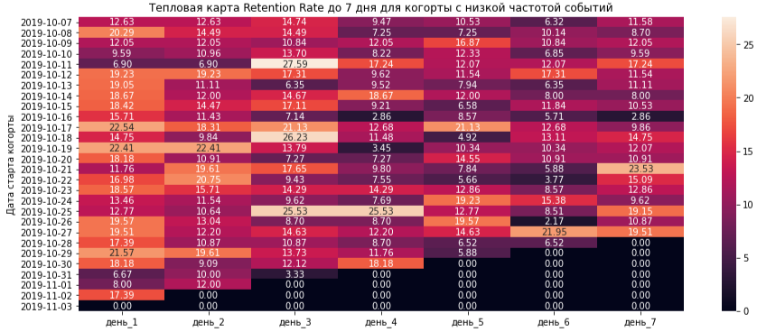
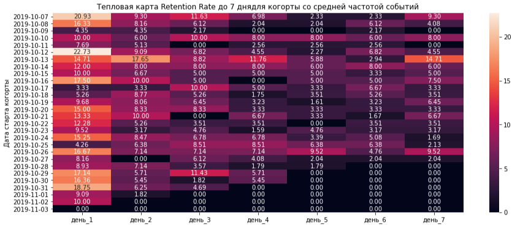
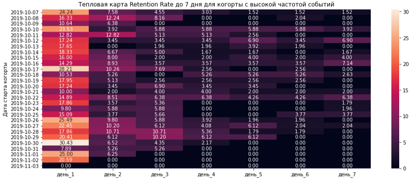

# Название проекта: Выделение групп пользователей на основе поведения

## Цель
Определить группы пользователей, у которых выше удержание в мобильном приложении "Ненужные вещи" и выше конверсия в целевое ("contacts_show") действие

## Данные
4 293 пользователя, 74 197 событий, период 7 октября – 3 ноября 2019, источники (Google, Yandex, other)

## Предобработка данных
- Изменение типа данных для столбца с датой и временем;
- Изменение названий столбцов для удобства;
- Проверены дубликаты: явных дубликатов не найдено, заменены неявные (show_contacts на contacts_show);
- Проверены гипотезы.

## Анализ и выводы
Для анализа использовались расчет различных метрик и построение графиков в Python. Метрики: удержание на 7-й день 4,3-10,6% по когортам; общая конверсия 23%; Google 24,4%, Yandex 24,7%, other 18,5%; по частоте: высокая 26%, низкая 23%, средняя 20%. Гипотезы: Google vs Yandex, p = 0,82 (различий нет); утро vs вечер 14,9% vs 18,4%, p = 0,033.

**Ключевой вывод:** Удерживается лучше группа, у которой частота совершения действий низкая, а конверсия в целевое действие выше у группы с высокой частотой действия.

## Визуализация

## Рекомендации:

1. обратить внимание на группы пользователей, поделенные по частоте совершения действий. С чем может быть связано то, что наиболее активные пользователи удерживаются хуже, чем те, что совершают действия в приложении реже. Либо юзеры быстро находят то, что их интересует, либо их со временем перестает привлекать приложение. Возможно необходимо настроить push-уведомления, чтобы пользователи заходили чаще;
2. чтобы улучшить конверсию в утреннее время, нужно проверить A/B-тестом утренний пуш с подборкой товаров, целевая метрика: конверсия в contacts_show.

**Инструменты:** Python (Pandas, Matplotlib, Seaborn, Scipy).
